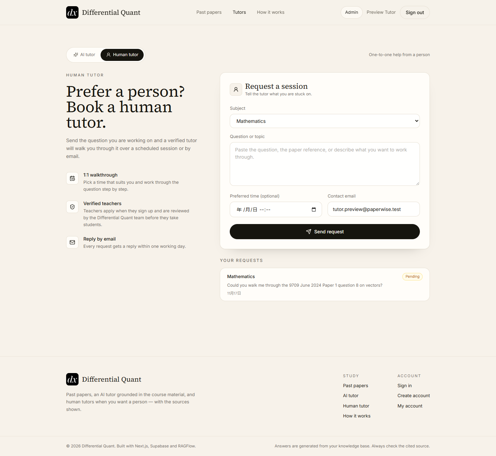
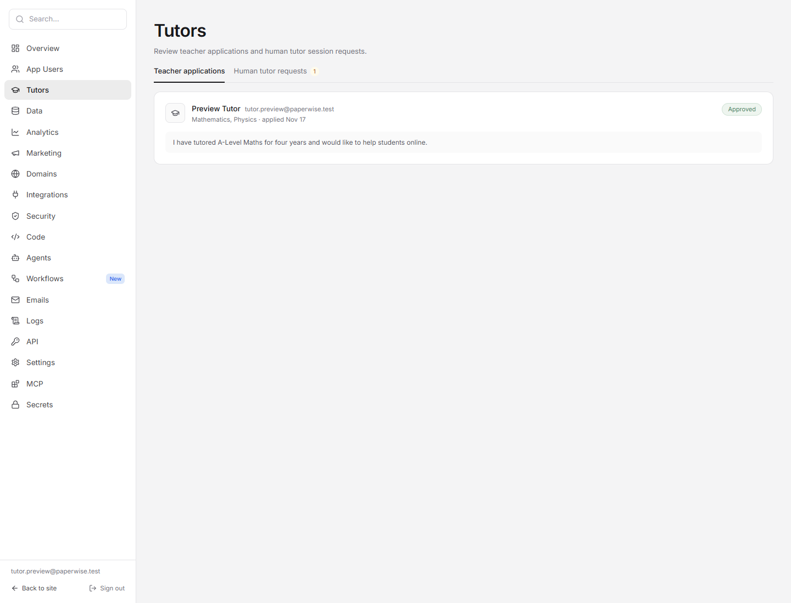

# Differential Quant

Past papers, an AI tutor grounded in your own knowledge base, and human tutors on demand.

- **Frontend**: Next.js 15 (App Router) → static export, hosted on GitHub Pages
- **Accounts**: Supabase Auth (email + password, email verification) & PostgreSQL
- **AI tutor**: RAGFlow, via its native or OpenAI-compatible chat endpoint
- **Human tutors**: requests are stored in Supabase and reviewed in the admin dashboard
- **Archive**: RAGFlow dataset documents (fallback: Supabase `papers` table, then sample data)

The brand mark is the supplied **dx** image (cropped and exported to `public/brand-mark.png`, favicon and Apple touch icon). The interface keeps the warm cream canvas and editorial serif type, now using Source Serif 4 for flatter, wider display letterforms.

| Landing | Archive | AI tutor |
| --- | --- | --- |
|  |  |  |

**Deployed:** [timi114514.github.io/TiMi.github.io](https://timi114514.github.io/TiMi.github.io/)

Already configured in the Supabase project `wksdpsmxwybsmtjjipxa`:

- `profiles`, `papers`, `downloads`, `page_views`, `admins`, `teacher_applications`, `human_tutor_requests` tables with RLS and six starter papers
- Email/password auth with confirmation required
- Site URL `https://timi114514.github.io/TiMi.github.io/` and redirect allow-list for `/auth/callback` (plus `http://localhost:3000/**`)

Still environment-dependent:

- RAGFlow runs on the owner's machine (`http://localhost:9380`). The public site therefore reads the archive from Supabase and the tutor reports a connection error until RAGFlow gets a public URL (tunnel or server). On the owner's machine the tutor and the full 700-document archive work.
- Supabase's built-in email sender has low limits. Add custom SMTP (Authentication → Emails) for reliable verification in production.

## Tutors: AI and human

Both live under **/tutor**, with a two-pill switcher:

- **/tutor** — AI tutor. Streams RAGFlow answers with citation chips; conversation context is kept through a RAGFlow session id.
- **/tutor/human** — human tutor. Signed-in, verified students submit the subject, question, preferred time and contact email. Requests land in `human_tutor_requests` with `pending` status and the student sees their own request history.



### Teacher applications

The sign-up form has an optional **Apply to become a teacher** checkbox. It reveals subjects and an introduction; on successful sign-up the application is written to `teacher_applications` as `pending`. Admins review it under **Admin → Tutors** and can approve or reject. The student's account page shows the review status.

- Public insert policy: only `pending` rows, so nobody can self-approve.
- Students can read only their own application (RLS), admins can read and update everything.
- Approved teachers are the pool used for human tutor sessions.

## Archive access

Browsing and downloading are public — no account is required.

- Guests are limited to **one document per second**. The timestamp lives in `sessionStorage` and the check runs before the RAGFlow or Supabase download starts.
- This is a client-side throttle; a static GitHub Pages site cannot enforce a hard server-side rate limit. If you need strict enforcement, proxy downloads through a Cloudflare Worker or Supabase Edge Function (RAGFlow must be publicly reachable first).
- Signed-in users are not throttled, and their downloads are logged to the `downloads` table.
- Archive responses are cached in `sessionStorage` for five minutes, so navigating back to `/papers` does not re-query all eight RAGFlow datasets.

## Password reset

- `/forgot-password` calls `supabase.auth.resetPasswordForEmail` with `redirectTo = /auth/reset`.
- `/auth/reset` waits for the recovery session, then calls `updateUser({ password })`.
- Supabase's redirect allow-list already covers `/auth/reset` through the `/**` patterns.
- The built-in email sender is rate-limited; configure SMTP before relying on reset emails.
- Administrator sign-in (password or email-confirmation link) redirects straight to `/admin`; everyone else lands on `/account`.

## Motion

Animations are pointer-driven and transform-only:

- the hero paper stack follows the mouse through one `requestAnimationFrame` handle;
- buttons, the logo and cards animate on hover;
- admin bars transition their width.

No timers, polling or additional requests drive the visuals, and `prefers-reduced-motion` disables them. The analytics page refreshes only on open, on manual refresh, and at most every five minutes while the tab is visible.

## Admin dashboard

Sign in with **JackyChen2027@outlook.com**; a successful administrator sign-in redirects straight to **/admin** (an **Admin** link also appears in the header).

> The account was created through the site, added to the `admins` table, and its email was confirmed directly in Supabase because the built-in email sender was rate-limited at setup time. Sign in with the password chosen at registration; add custom SMTP for future verification emails.


The shell mirrors the reference: search, Overview, App Users, Tutors, Data, Analytics, Marketing, Domains, Integrations, Security, Code, Agents, Workflows, Emails, Logs, API, Settings, MCP and Secrets.

Working sections:

- **Analytics** — total visits, unique visitors, average visit duration, live visitors, daily traffic chart, page traffic and country breakdown, 7/14/30/90-day ranges, tabs for Traffic overview / Sales overview / Session recordings.
- **Overview** — traffic, account, archive and download summary.
- **App Users** — every Supabase Auth account with verification status and last sign-in.
- **Tutors** — approve/reject teacher applications and triage human tutor requests (`pending → contacted → closed`).
- **Data** — add, publish/unpublish and delete fallback papers in Supabase.
- **Logs** — recent downloads and raw page views.
- **Settings** — add/remove administrators, inspect the deployment and adjust the admin-only RAGFlow connection override (the panel is no longer shown to visitors).
- Marketing, Domains, Integrations, Security, Code, Agents, Workflows, Emails, API, MCP, Secrets render structured placeholders.



How the admin access works:

```sql
-- supabase/schema.sql
create table public.admins (email text primary key, created_at timestamptz default now());
create function public.is_admin() returns boolean ... -- checks auth.jwt()->>'email'
```

- Every admin RPC (`admin_analytics`, `admin_list_users`) checks `is_admin()` and is `security definer`.
- RLS grants admins read access to `page_views`, `downloads`, `profiles` and full access to `papers`; everyone else is unchanged.
- Manage the allow-list in **Admin → Settings** or by inserting into `admins`.

Traffic collection is first-party and privacy-friendly: `page_views` stores only the path, an anonymous session id, an optional user id, the referrer, and a coarse country estimate from the browser time zone. No IP addresses and no cookies.

---

## 1. Quick start (local)

```bash
cd paperwise
npm install
npm run dev          # http://localhost:3000
```

Copy `.env.example` to `.env.local` and fill in:

| Variable | Where to get it |
| --- | --- |
| `NEXT_PUBLIC_SUPABASE_URL` | Supabase → Project Settings → API → Project URL |
| `NEXT_PUBLIC_SUPABASE_ANON_KEY` | Supabase → Project Settings → API → `anon` `public` key |
| `NEXT_PUBLIC_RAGFLOW_BASE_URL` | RAGFlow API server, e.g. `http://localhost:9380` |
| `NEXT_PUBLIC_RAGFLOW_API_KEY` | RAGFlow → User settings → API keys |
| `NEXT_PUBLIC_RAGFLOW_CHAT_ID` | RAGFlow → Chat → your assistant (URL contains the id) |
| `NEXT_PUBLIC_RAGFLOW_DATASET_ID` | Comma-separated dataset ids from RAGFlow → Knowledge base (optional; powers the archive) |
| `NEXT_PUBLIC_BASE_PATH` | GitHub Pages project path, e.g. `/TiMi.github.io`; empty for user sites / custom domains |

`NEXT_PUBLIC_*` values are inlined into the browser bundle at build time. That is unavoidable for a fully static site — use a dedicated, revocable RAGFlow API key.

---

## 2. Supabase setup

1. Create a project at [supabase.com](https://supabase.com) (the one referenced here: `wksdpsmxwybsmtjjipxa`).
2. Open **SQL Editor** and run [`supabase/schema.sql`](supabase/schema.sql). It creates the archive, account, analytics and tutor tables, RLS policies, admin functions and a starter archive.
3. **Authentication → Providers → Email**: enable it. Keep *Confirm email* ON so accounts are email-verified.
4. **Authentication → URL Configuration**:
   - Site URL: `https://timi114514.github.io/TiMi.github.io/` (or your local `http://localhost:3000`)
   - Redirect URLs:
     - `https://timi114514.github.io/TiMi.github.io/auth/callback`
     - `https://timi114514.github.io/TiMi.github.io/auth/reset`
     - `http://localhost:3000/auth/callback`
     - `http://localhost:3000/auth/reset`
5. Copy the **anon public** key into `.env.local` / GitHub secrets. Never use the `service_role` key in this app.
6. Optional email template check: **Authentication → Email Templates → Confirm signup** and **Reset password** should link to `{{ .ConfirmationURL }}`.

> Verification is performed by Supabase. The site redirects to `/auth/callback`, picks up the session, then sends administrators to `/admin` and everyone else to `/account`.

---

## 3. RAGFlow setup

The app talks to RAGFlow from the browser, so the RAGFlow API server must be reachable from the visitor's browser and allow CORS. Both are true for the local instance tested here (`access-control-allow-origin: *`).

1. In RAGFlow create (or reuse) a **chat assistant** and note its `chat_id`. The assistant's `llm_id` is discovered automatically when OpenAI mode is selected.
2. Create an **API key** in user settings.
3. Ingest your past papers and course material into one or more **datasets** (knowledge bases). The archive reads every dataset listed in `NEXT_PUBLIC_RAGFLOW_DATASET_ID` (comma separated, first 100 documents each, "Show more" paginates in the UI).
4. The tutor supports two transports, switchable in **Admin → Settings → RAGFlow connection** (stored in `localStorage`, admin browsers only):
   - **RAGFlow native** (default) — `POST {baseUrl}/api/v1/chats/{chat_id}/completions`. Streams `data.answer` deltas, keeps context through `session_id`, and returns `reference.chunks[].document_name` for the citation chips.
   - **OpenAI-compatible** — `POST {baseUrl}/api/v1/chats_openai/{chat_id}/chat/completions` with `{model, messages, stream}`. RAGFlow requires `model` to be the assistant's internal `llm_id`; the app resolves it via `GET /api/v1/chats` and caches it. This transport does not return citations, so the UI quietly falls back to native mode when the facade rejects the request.
5. **Archive API**:
   ```
   GET  {baseUrl}/api/v1/datasets?page=1&page_size=100                 # dataset names → subjects
   GET  {baseUrl}/api/v1/datasets/{dataset_id}/documents?page=1&page_size=100
   GET  {baseUrl}/api/v1/datasets/{dataset_id}/documents/{document_id} # authenticated download
   ```
   File names like `9700_w19_ms_22.pdf` are turned into readable titles ("9700 · November 2019 · Mark scheme 22"), subjects come from the dataset name, and years come from the file name. If no dataset id is set, the app reads the Supabase `papers` table, then falls back to sample cards.
6. **CORS**: if your deployment does not send `Access-Control-Allow-Origin` for the site origin, put a small reverse proxy in front (Nginx `add_header 'Access-Control-Allow-Origin' '*'` plus preflight handling) or use a tunnel with CORS.
7. **Localhost isn't public**: a site served from GitHub Pages cannot reach `http://localhost:9380` on your machine. Until RAGFlow is exposed:
   - Cloudflare Tunnel / ngrok / frp → put the public URL in **Admin → Settings → RAGFlow connection**, or
   - deploy RAGFlow to a public server and set `NEXT_PUBLIC_RAGFLOW_BASE_URL`.

   The connection panel is admin-only. Visitors always use the values compiled into the build; they never see the base URL, key, chat id or dataset ids.

---

## 4. Deploy to GitHub Pages

**Live:** https://timi114514.github.io/TiMi.github.io/

Repository: `https://github.com/TiMi114514/TiMi.github.io`

Because the repository is not named `TiMi114514.github.io`, Pages serves it as a **project site**:

```
https://timi114514.github.io/TiMi.github.io/
```

So `NEXT_PUBLIC_BASE_PATH` is `/TiMi.github.io` (the workflow defaults to it; the repo variable can override it). If you later rename the repo to `TiMi114514.github.io` or attach a custom domain, set the variable to empty.

Pages is configured with **Build and deployment → Source: GitHub Actions**. The workflow has built-in defaults for every non-secret value (Supabase URL + publishable key, RAGFlow chat id / dataset ids, base path), so only the RAGFlow API key needs adding as a repository variable or secret:

- Variable or secret: `NEXT_PUBLIC_RAGFLOW_API_KEY`
- Optional overrides: `NEXT_PUBLIC_SUPABASE_URL`, `NEXT_PUBLIC_SUPABASE_ANON_KEY`, `NEXT_PUBLIC_RAGFLOW_BASE_URL`, `NEXT_PUBLIC_RAGFLOW_CHAT_ID`, `NEXT_PUBLIC_RAGFLOW_DATASET_ID`, `NEXT_PUBLIC_BASE_PATH`

Push to `main` and [`.github/workflows/deploy.yml`](.github/workflows/deploy.yml) publishes `out/`.

Local production build:

```bash
npm run build         # emits ./out
npx serve out         # preview
```

### Integration checks

```bash
npx tsx scripts/test-ragflow.ts     # archive + native/OpenAI chat + follow-up session
```

The local RAGFlow instance used during development responded on `http://localhost:9380`, CORS `*`, assistant `f37a7a58e16c11f19cd2051ed6437597` (Biology dataset) and seven other A-Level datasets. The test prints 700 archive documents and citation names.

---

## 5. How the pieces fit

```
Browser (GitHub Pages, static)
 ├─ Supabase JS ──────────── auth (email verify) + papers/downloads (RLS)
 └─ fetch ────────────────── RAGFlow chat (native or OpenAI-compatible) + dataset API
```

- Browsing and downloading are public; guests are throttled to one document per second. Both tutors require a signed-in, verified account.
- The AI tutor streams tokens and renders the cited documents under each answer; human tutor requests are stored in Supabase and triaged by admins.
- Downloads are fetched with the RAGFlow key, then saved through a blob URL; RAGFlow's `Content-Disposition` is not required.
- Download history is best-effort logged to `downloads` for signed-in users (RLS keeps it per-user).
- Archive results are cached in `sessionStorage` for five minutes; analytics polling is five minutes and pauses on hidden tabs.
- No server is required: `next build` produces a pure static `out/` directory.

> **Windows / exFAT note**: this repository was built from an exFAT drive, where `readlink()` on regular files reports `EISDIR` and breaks Next.js file tracing. `scripts/patch-fs.cjs` normalizes that behaviour and `scripts/next.cjs` loads it for the build and every worker. On NTFS / Linux it is a no-op.

### Security notes

- The RAGFlow key reaches the browser bundle. Treat it as public and revocable; create a dedicated key.
- Supabase RLS: papers are read-only publicly (published only), downloads/teacher applications/human requests are per-user, profiles are self-only. Admin writes are gated by `is_admin()`.
- The guest one-download-per-second check is client-side. It is a fair-use throttle, not a security boundary; use a proxy if you need hard enforcement.
- Do not put the Supabase `service_role` key into any `NEXT_PUBLIC_*` variable.
- For production-grade key hiding, add a proxy (e.g. a Supabase Edge Function or Cloudflare Worker) later; the client API layer is isolated in `lib/ragflow.ts`.

---

## 6. File map

```
app/
  page.tsx              landing page (hero, archive preview, tutor section)
  papers/page.tsx       public archive: search, filters, guest-throttled downloads
  tutor/page.tsx        AI tutor with auth gating
  tutor/human/page.tsx  human tutor request form + request history
  login|signup|verify   email/password auth flow; optional teacher application
  forgot-password/page.tsx  request a reset link
  auth/reset/page.tsx   choose a new password from the recovery link
  account/page.tsx      profile, verification status, teacher application, downloads
  admin/                Analytics, Overview, App Users, Tutors, Data, Logs, Settings, placeholders
  auth/callback/page.tsx  Supabase email-confirmation landing
components/             Header, Footer, HeroPapers, PaperCard, ChatPanel, TutorTabs, AdminShell, AnalyticsTracker
lib/
  supabase.ts           client + appUrl()
  ragflow.ts            native/OpenAI-compatible chat, dataset listing/download
  analytics.ts          admin analytics types, country estimate, formatters
  papers.ts             archive loading, five-minute cache, sample fallback
public/                 brand-mark.png, favicon.png, apple-touch-icon.png
supabase/schema.sql     tables, RLS, functions, starter rows
.github/workflows/      GitHub Pages deployment
```

---

## 7. Troubleshooting

| Symptom | Fix |
| --- | --- |
| Blank page after deploy, `/repo/_next/...` 404s | Wrong `NEXT_PUBLIC_BASE_PATH`; it must match the repo path, e.g. `/TiMi.github.io` |
| Sign-up works but no email | Supabase → Authentication → Email is disabled, or SMTP is not configured; use the default email service or add custom SMTP |
| Password reset email never arrives | The built-in sender is rate-limited; add SMTP and retry after the limit resets |
| Email link returns to `localhost` | Add the GitHub Pages URL to Supabase **Redirect URLs** |
| Tutor says "tutor unavailable" | Fill the chat assistant id under **Admin → Settings → RAGFlow connection** |
| Guest cannot download a second paper immediately | Expected: guests are limited to one document per second |
| Tutor request fails with CORS | Allow the Pages origin on RAGFlow, or use a CORS-enabled tunnel |
| Archive shows demo cards | No RAGFlow dataset id and no Supabase papers rows; run `schema.sql` and/or set the dataset id |
| `npm ci` fails in Actions | Commit `package-lock.json` (`npm install` locally first) |
